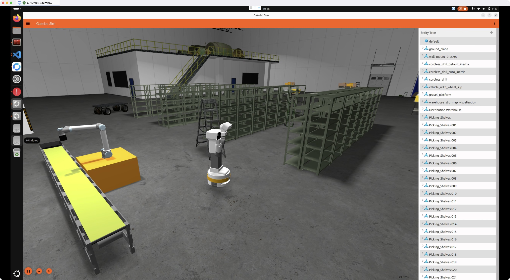

# TIAGo Jetty

ROS 2 Lyrical에서 TIAGo를 Gazebo Jetty 창고 월드와 함께 실행하는 실습 패키지입니다.

TIAGo의 주행, 7축 팔, 몸통, 머리, 그리퍼와 레이저·RGB-D 카메라·IMU를 사용할 수 있습니다. 기존 `play_motion2` 명령도 그대로 사용합니다.



## 설치

Ubuntu 26.04에 [ROS 2 Lyrical Desktop](https://docs.ros.org/en/lyrical/Get-Started/Installation/Ubuntu-Install-Debs.html)이 설치된 환경에서 진행합니다.

```bash
mkdir -p ~/ros2_ws/src
cd ~/ros2_ws/src
git clone https://github.com/robby-404canfind/tiago_jetty.git
cd tiago_jetty
bash scripts/setup.bash
```

설치 스크립트가 ROS 의존성, 공식 Jetty 월드의 모델 파일을 받아 패키지를 빌드합니다. 모델 파일을 받는 동안 인터넷 연결이 필요합니다.

## 실행

```bash
source ~/ros2_ws/install/setup.bash
ros2 launch tiago_jetty bringup.launch.py
```

NVIDIA와 내장 그래픽을 함께 사용하는 노트북에서는 아래처럼 실행해줍니다.

```bash
ros2 launch tiago_jetty bringup.launch.py nvidia:=true
```

처음 실행할 때는 월드의 모델을 읽는 데 시간이 걸릴 수 있습니다. Gazebo 화면이 열린 후 아래 명령어로 제어기들이 `active` 상태인지 확인할 수 있습니다.

```bash
ros2 control list_controllers
```

다른 터미널에서 키보드로 주행해 볼 수 있습니다.

```bash
source ~/ros2_ws/install/setup.bash
ros2 run teleop_twist_keyboard teleop_twist_keyboard
```

손을 흔드는 동작은 아래와 같이 실행합니다.

```bash
ros2 action send_goal /play_motion2 play_motion2_msgs/action/PlayMotion2 "{motion_name: 'wave'}"
```

몸통을 움직여 볼 수 있습니다.

```bash
ros2 action send_goal /torso_controller/follow_joint_trajectory control_msgs/action/FollowJointTrajectory "{trajectory: {joint_names: ['torso_lift_joint'], points: [{positions: [0.35], time_from_start: {sec: 3}}]}}"
```

RViz도 함께 열려면 `rviz:=true`, 화면 없이 실행하려면 `gui:=false`를 추가합니다. 로봇의 생성 위치는 `x`, `y`, `z`, `yaw`로 바꿀 수 있습니다.

## 주요 인터페이스

| 용도 | 토픽 또는 액션 |
|---|---|
| 주행 명령 | `/cmd_vel` (`geometry_msgs/msg/Twist`) |
| 주행 거리 | `/mobile_base_controller/odom` |
| 레이저 | `/scan_raw` |
| RGB 이미지 | `/head_front_camera/rgb/image_raw` |
| 깊이 이미지 | `/head_front_camera/depth/image_raw` |
| 포인트 클라우드 | `/head_front_camera/depth/points` |
| IMU | `/base_imu` |
| 관절 상태 | `/joint_states` |
| 좌표 변환 | `/tf`, `/tf_static` |
| 미리 정의한 동작 | `/play_motion2` |
| 관절 제어 | `/{arm,torso,head,gripper}_controller/follow_joint_trajectory` |

## 실행 확인

시뮬레이션이 실행된 터미널과 같은 ROS 환경에서 아래 명령어를 실행합니다. `--drive --actions`를 지정하면 로봇을 짧게 주행시키고 몸통·머리·그리퍼·손 흔들기 동작을 실행합니다.

```bash
ros2 run tiago_jetty verify_sim.py --drive --actions --output /tmp/tiago_jetty_check.json
```

센서 데이터만 확인하려면 `--drive --actions`를 빼고 실행합니다.

Ubuntu 26.04 / Lyrical / Gazebo 10.5.0 환경에서 주행, 회전, 센서·TF 수신과 네 가지 액션을 확인했습니다. 측정 결과와 실행 성능은 [VALIDATION.md](VALIDATION.md)에 정리했습니다.

## 출처

- 로봇 모델 및 동작: [PAL Robotics](https://github.com/pal-robotics)
- 창고 월드: [Gazebo Jetty Demo](https://github.com/gazebosim/jetty_demo)

사용한 소스 버전은 [SOURCES.json](SOURCES.json), 원본과 변경 내용은 [THIRD_PARTY.md](THIRD_PARTY.md)에 정리했습니다. 팔의 가속도 설정은 시뮬레이션용이며 실제 로봇의 사양을 나타내지 않습니다.
